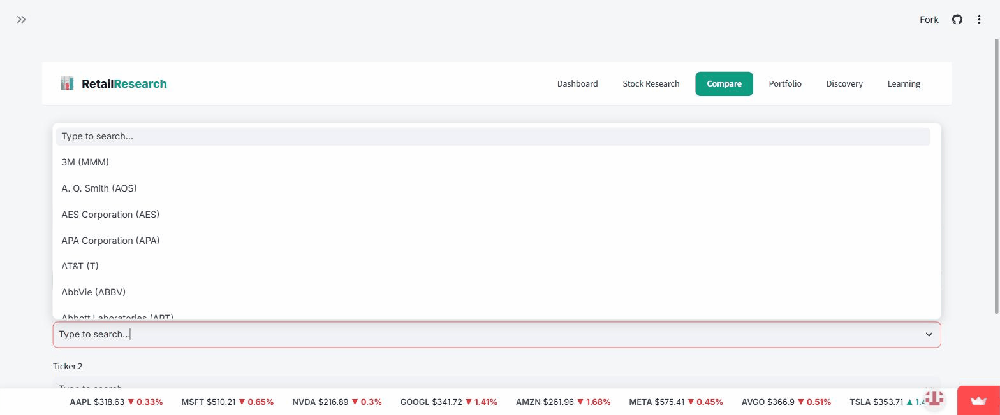
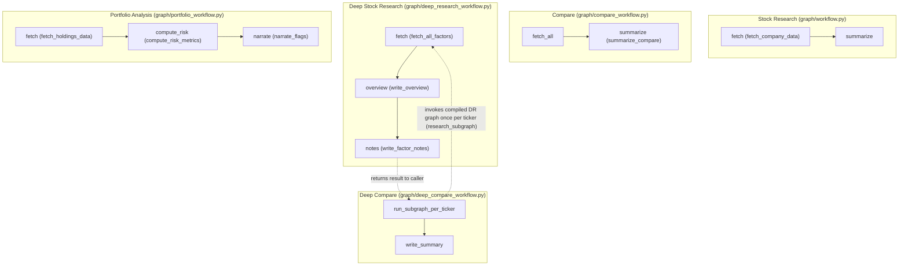

# Retail Research Assistant

An S&P 500 research platform: an agentic assistant that pulls market data and helps research retail-sector (and broader S&P 500) equities.

**Live app:** https://retailresearch-raj.streamlit.app/

## Demo


## Stack
- Streamlit (frontend)
- LangGraph + LangChain (OpenAI) — agent orchestration
- yfinance / pandas — market data
- SQLite (`cache.sqlite3`, `history.sqlite3`) — caching and history

## Architecture

The app is not one graph but five separate LangGraph workflows in `graph/`, one per feature. `graph/nodes.py` holds shared node implementations used by Stock Research; Deep Compare reuses the compiled Deep Stock Research graph itself as a subgraph rather than duplicating its logic.



## Run locally
```bash
pip install -r requirements.txt
streamlit run frontend/app.py
```
